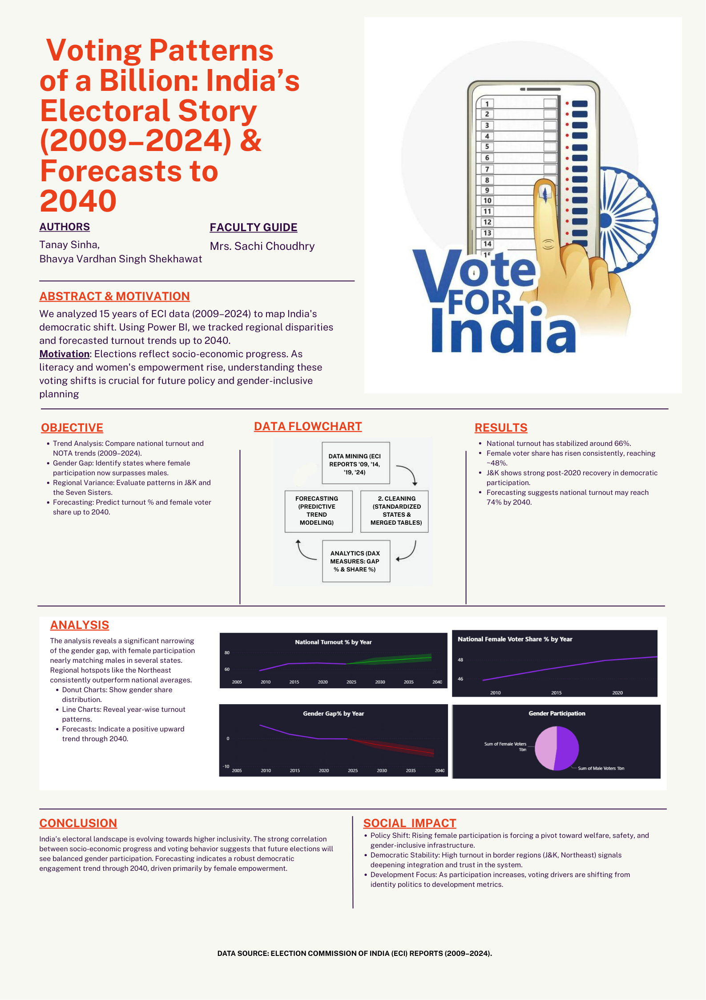
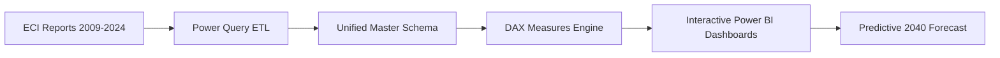

# 🗳️ Voting Patterns of a Billion: India's Electoral Trends (2009–2024 & Forecast till 2040)

[](https://powerbi.microsoft.com/)
[](https://learn.microsoft.com/en-us/dax/)
[](https://www.microsoft.com/en-us/microsoft-365/excel)
[](https://www.upes.ac.in/)

> **An in-depth empirical and predictive business intelligence study of Indian General Elections across four election cycles (2009, 2014, 2019, and 2024) with predictive turnout and gender parity modeling up to 2040.**

---

## 📌 Executive Summary

India's electorate of nearly **1 billion citizens** represents the largest democratic exercise on Earth. However, historical data published by the **Election Commission of India (ECI)** has remained fragmented across disparate annual reports, varying tabular formats, and isolated metrics.

This project unifies **15 years of national electoral data (2009–2024)** into an interactive, multi-view Power BI dashboard suite. It addresses critical questions around voter turnout, the closing gender gap (SDG 5), Union Territory performance, regional disparities (SDG 10), NOTA adoption, and predictive trajectory toward 2040.

---

## 🖼️ Project Visual Overview

<div align="center">
  
</div>

---

## 👥 Authors & Academic Context

* **Tanay Sinha** — *School of Computer Science, UPES, Dehradun*
* **Bhavya Vardhan** — *School of Computer Science, UPES, Dehradun*
* **Course**: Data Visualization & Business Intelligence (DVI Assignment 3)

---

## 📊 Key Highlights & Findings

| Dimension | Key Observations & Trends |
| :--- | :--- |
| **National Turnout (2024)** | **66.10%** overall national turnout with **0.99%** NOTA share across parliamentary constituencies. |
| **Gender Parity (SDG 5)** | Rapid narrowing of the gender turnout gap; female participation surged from **55.8% (2009)** to near-parity with male turnout in 2019/2024. |
| **High-Engagement Regions** | Northeastern states (Nagaland, Tripura, Assam) and select UTs (Lakshadweep) consistently register turnout rates exceeding **75%–80%**. |
| **Predictive Forecast (2040)** | Statistical time-series trendlines predict national turnout climbing towards **~75%**, with female voter numbers projected to surpass male turnout in future cycles. |

---

## 🖥️ Analytical Dashboard Views

The Power BI solution (`Report.pbix`) comprises **7 structured analytical views**:

1. **National Snapshot (2024)**: High-level KPIs, total electors, total votes polled, NOTA percentage, and macro metrics.
2. **State-Wise Historical Trends**: Comparative multi-election cycle performance across Indian states and Union Territories.
3. **Gender Participation & Parity**: Analysis of female electors vs. male electors, turnout ratios, and empowerment trends over time.
4. **Union Territory Dynamics**: Deep dive into voting patterns across Chandigarh, Delhi, Puducherry, Lakshadweep, Andaman & Nicobar, and Ladakh.
5. **Special Regional Focus — Jammu & Kashmir**: Electoral participation shift before and after structural reorganizations.
6. **Northeast Regional Excellence**: Exploration of high-voter-density states and socio-political engagement drivers.
7. **Predictive Forecasting (2025–2040)**: Power BI analytics forecasting voter turnout, demographic volume growth, and gender parity trajectories.

---

## 🛠️ Data Engineering & Modeling Workflow



1. **Data Extraction**: Harvested raw electoral, turnout, elector counts, and gender participation tables from the official Election Commission of India (ECI) portals.
2. **Data Cleaning & Standardization (Power Query)**:
   - Harmonized state/UT names across historical boundaries (e.g., Andhra Pradesh / Telangana split, J&K reorganization).
   - Filtered noise, handled null values, and merged multi-year tables into a master schema (`Final Dataset.xlsx`).
3. **DAX Modeling**:
   - Developed dynamic DAX measures for Turnout %, Female Voter %, Gender Gap %, NOTA %, and regional share metrics.
4. **Visual Analytics & Custom Components**:
   - Utilized custom visual components (including Three.js visual integration `.pbiviz`) for advanced multi-dimensional charts.

---

## 📁 Repository Structure

```
├── Datasets/                               # Historical raw datasets by election year
│   ├── 2009/                               # ECI data & reports (PDF & XLSX)
│   ├── 2014/                               # State-wise turnout & electors
│   ├── 2019/                               # Turnout, electors, and female participation
│   └── 2024/                               # 2024 General Election official figures
├── Visuals/                                # Custom Power BI visuals (.pbiviz)
├── Final Dataset.xlsx                      # Cleaned master consolidated dataset
├── Report.pbix                             # Interactive Power BI report source file
├── Report.pdf                              # Exported full project report & dashboard views
├── Poster.png                              # Project poster & presentation banner
├── .gitignore                              # Git exclusion rules
└── README.md                               # Project documentation
```

---

## 🎯 UN Sustainable Development Goals (SDGs) Alignment

* **Goal 5: Gender Equality (Target 5.5)** — Ensures women's full and effective participation and equal opportunities for leadership at all levels of political decision-making.
* **Goal 10: Reduced Inequalities (Target 10.2)** — Promotes universal social, economic, and political inclusion irrespective of age, sex, disability, race, ethnicity, or origin.
* **Goal 16: Peace, Justice, and Strong Institutions (Target 16.7)** — Analyzes responsive, inclusive, participatory, and representative decision-making at all levels.

---

## 🚀 How to Run & Explore the Project

1. **Prerequisites**: Install [Microsoft Power BI Desktop](https://powerbi.microsoft.com/desktop/) (free).
2. **Clone the Repository**:
   ```bash
   git clone https://github.com/TanaySinha17/india-election-analytics-2009-2040.git
   ```
3. **Open the Report**:
   - Double-click [`Report.pbix`](./Report.pbix) to explore all interactive DAX measures, filters, and forecast views.
   - Alternatively, review the static analytical PDF report [`Report.pdf`](./Report.pdf).

---

## 📜 License & Acknowledgments

* **Data Source**: [Election Commission of India (ECI)](https://results.eci.gov.in/)
* **Academic Institution**: School of Computer Science, University of Petroleum and Energy Studies (UPES), Dehradun.
